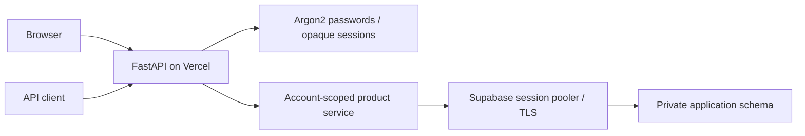

# QQ Pay: architecture and tradeoffs

## Separation of concerns

`accounts.py` owns identity, session digests, key revocation, origin checks and rate limiting. `product.py` owns domain transactions and route authorization. `app.py` composes both and retains the original engineering-lab endpoints behind the operator API key or bounded public lab actions. `assets/accounts.js` owns login and API-key UI; each application's `assets/application.js` and theme implements its domain workflow.

## Identity and isolation

Every private product query is constrained by the authenticated account ID. Clients cannot choose an owner ID. Ownership is checked before mutating or returning details. Device writes and public checkout links are explicit capability boundaries, not a way to list another account's records. Browser mutations check the Origin header; cross-origin requests are rejected. API clients use a bearer key. Tokens contain 256 bits of random entropy and only their hashes are stored. Passwords use the Argon2 implementation provided by pwdlib.

Accounts are scoped to the application schema; a Pocket account is not a Pay or Kashmir account. Schemas are revoked from Supabase's anonymous and authenticated API roles. The services currently share a database owner connection, so schema separation is not a defense against a compromised service credential. Separate least-privilege database roles are planned.

### Payment guarantees

Amounts use integer minor units. Idempotency keys are unique within an account; conflicting requests return HTTP 409. Capture performs a conditional pending-to-captured update and writes two ledger entries in one transaction. Repeating capture creates no extra entries. Full refund performs the reverse transition and adds reversal entries atomically; repeated refunds do not duplicate them. Cancelled or refunded checkouts cannot be paid again. Every transition adds an activity event.

Checkout URLs are intentionally public and unguessable UUID links. They disclose the checkout title, merchant username, amount, currency and status to their holder. Merchant lists, refunds, cancellations, ledger details and API keys require account ownership.

This release uses the **built-in sandbox**, as requested. It does not charge cards, settle funds or integrate a bank/provider. No card data is collected. Partial refunds, signed webhooks and external reconciliation are future features. A workspace holds up to 500 checkouts. Dashboard INR totals do not aggregate other currencies.

## Feasible scaling path

The present design deliberately starts with one managed database and stateless API instances. Database transactions own correctness; adding API replicas does not provide unlimited database capacity. SQLAlchemy NullPool avoids per-instance idle pools, while Supabase session pooling manages backend connections. Indexed owner and readiness lookups keep the current bounded queries predictable.

Before larger traffic: measure p50/p95 latency, lock wait time, connection utilization and write amplification; set workload budgets; add operational dashboards and alerts; move schema changes into a dedicated migration job; and exercise restore/failure drills. Do not claim request-per-second capacity without a reproducible benchmark.
